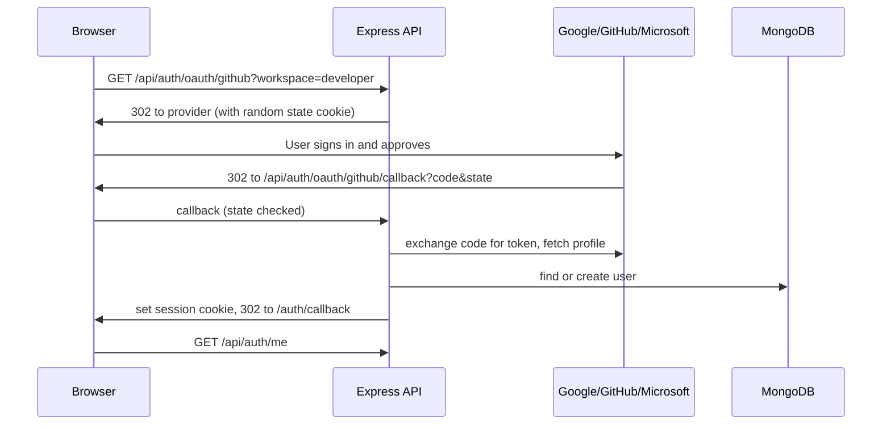

# Backend & OAuth Setup

Kinoesis has two parts that run side by side:

| Part | Folder | Runs on | What it does |
|---|---|---|---|
| Frontend | `src/` | http://localhost:5173 | React app (Vite). Proxies `/api/*` to the backend. |
| Backend | `server/` | http://localhost:4000 | Express API: email/password + Google/GitHub/Microsoft sign-in, stores users in MongoDB. |

> **MongoDB vs Postman** — they are different things. **MongoDB** is the *database* where user accounts are stored. **Postman** is a *testing tool* for sending requests to the API by hand. A ready-made collection is in `server/kinoesis.postman_collection.json` (Postman → Import).

---

## 1. Install

```bash
npm install            # frontend
npm run server:install # backend
```

## 2. Get a MongoDB database (pick one)

- **MongoDB Atlas (free, easiest):** https://www.mongodb.com/cloud/atlas → create a free M0 cluster → *Database Access*: add a user → *Network Access*: add your IP (or `0.0.0.0/0` for a demo) → *Connect → Drivers* and copy the `mongodb+srv://…` string. Add `/kinoesis` before the `?` so the database is named.
- **Local:** install [MongoDB Community Server](https://www.mongodb.com/try/download/community) and use `mongodb://127.0.0.1:27017/kinoesis`.

## 3. Create `server/.env`

Copy `server/.env.example` to `server/.env` and fill in `MONGODB_URI`, `JWT_SECRET`, and the OAuth keys below. Providers without keys just show a "not configured" message.

## 4. Create the OAuth apps

All redirect URLs go through the Vite dev server (port **5173**), which forwards them to the backend.

### GitHub
1. https://github.com/settings/developers → **OAuth Apps → New OAuth App**
2. Homepage URL: `http://localhost:5173`
3. Authorization callback URL: `http://localhost:5173/api/auth/oauth/github/callback`
4. Copy **Client ID**, click **Generate a new client secret** → `GITHUB_CLIENT_ID` / `GITHUB_CLIENT_SECRET`

### Google
1. https://console.cloud.google.com → create/select a project
2. **APIs & Services → OAuth consent screen**: External, fill app name + your email, add yourself as a **Test user**
3. **Credentials → Create credentials → OAuth client ID** → *Web application*
4. Authorized JavaScript origin: `http://localhost:5173`
5. Authorized redirect URI: `http://localhost:5173/api/auth/oauth/google/callback`
6. Copy → `GOOGLE_CLIENT_ID` / `GOOGLE_CLIENT_SECRET`

### Microsoft
1. https://entra.microsoft.com → **App registrations → New registration**
2. Supported account types: **Accounts in any organizational directory and personal Microsoft accounts**
3. Redirect URI: platform **Web**, `http://localhost:5173/api/auth/oauth/microsoft/callback`
4. Copy **Application (client) ID** → `MICROSOFT_CLIENT_ID`
5. **Certificates & secrets → New client secret** → copy the **Value** (not the ID) → `MICROSOFT_CLIENT_SECRET`

## 5. Run (two terminals)

```bash
npm run server   # terminal 1 — backend on :4000
npm run dev      # terminal 2 — frontend on :5173
```

The backend prints which providers are ready, e.g. `[oauth] google: ready, github: ready, microsoft: not configured`.

> Open the app at **http://localhost:5173** (not 127.0.0.1) — the OAuth redirect URLs must match exactly.

---

## Where the buttons appear

| Workspace | Buttons |
|---|---|
| Developer | GitHub, GitLab *(coming soon)* |
| Business | Google, Microsoft, SSO *(coming soon)* |

## API reference

| Method | Path | Body | Notes |
|---|---|---|---|
| GET | `/api/health` | – | `{ ok, db }` |
| GET | `/api/auth/providers` | – | Which OAuth providers have keys |
| POST | `/api/auth/signup` | `workspace, name, email, password, username? / company?, teamSize?` | Sets session cookie |
| POST | `/api/auth/signin` | `workspace, email, password` | Sets session cookie |
| GET | `/api/auth/me` | – | Current user or 401 |
| POST | `/api/auth/signout` | – | Clears cookie |
| GET | `/api/auth/oauth/:provider?workspace=` | – | Browser redirect to provider |
| GET | `/api/auth/oauth/:provider/callback` | – | Provider redirects here |

Errors are always `{ "error": { "code", "message" } }`.

## How OAuth works here



Passwords are hashed with bcrypt; sessions are JWTs in an httpOnly cookie, so JavaScript never sees a token.
